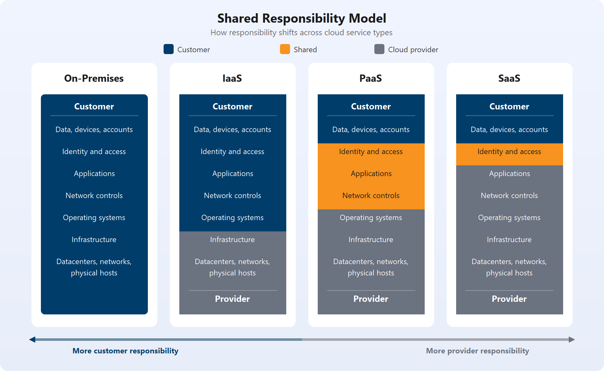

# Descrever a computação em nuvem

## Descrever os conceitos da nuvem

### Definir a computação em núvem

A computação em nuvem é a entrega de serviços de computação pela Internet

Serviços de núvem geralmente podem entregar:
- VMs
- Storage
- Database
- Network
- IoT
- ML
- IA

Diferente de uma infraestrutura de datacenter comum, a computação em núvem permite flexibilidade no investimento e no uso de recursos dependendo da demanda.

### Descrever o modelo de responsabilidade compartilhada

Em um datacenter local, a equipe é responsável por garantir toda a segurança física do datacenter, bem como toda a infraestrutura de software, atualização/patches de segurança do SO, etc.

Já no modelo de responsabilidade compartilhada, essas responsabilidades são divididas entre provedor de núvem e consumidor. 

Essa divisão depende do tipo de serviço de núvem, podendo ser de responsabilidade do provedor de núvem, do consumidor ou de ambos em alguns casos. Como demonstra a seguinte imagem:

> Os tipos de serviços em núvem serão detalhados posteriormente.

#### O que sempre fica com o usuário (consumidor da núvem)

- As informações e os dados armazenados na nuvem
- Dispositivos que têm permissão para se conectar à nuvem (celulares, computadores e assim por diante)
- As contas e identidades das pessoas, serviços e dispositivos em seu ambiente

#### O que o provedor sempre possui

- O datacenter físico
- A rede física
- Hosts físicos

#### O que depende do tipo de serviço

- Sistemas operacionais
- Controles de rede
- Aplicativos
- Identidade e acesso
- Infraestrutura
